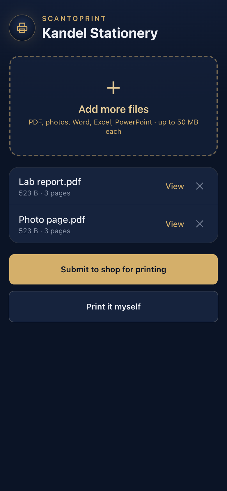
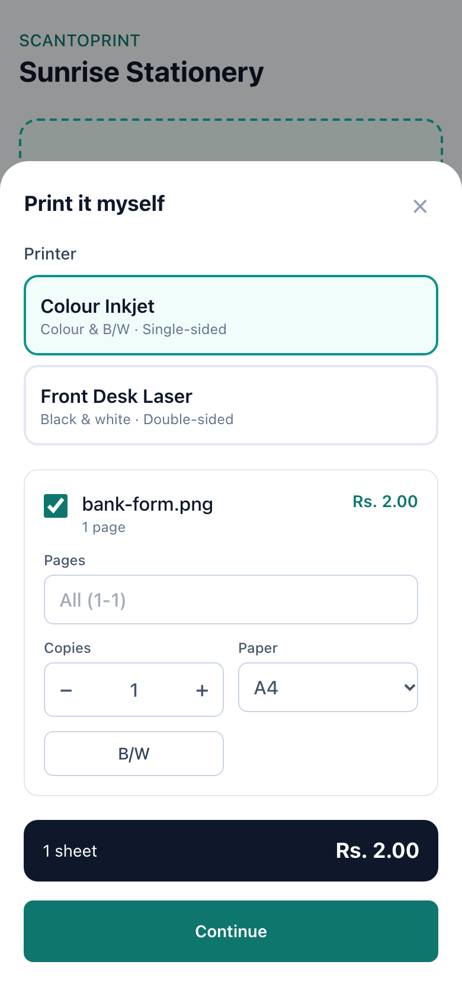
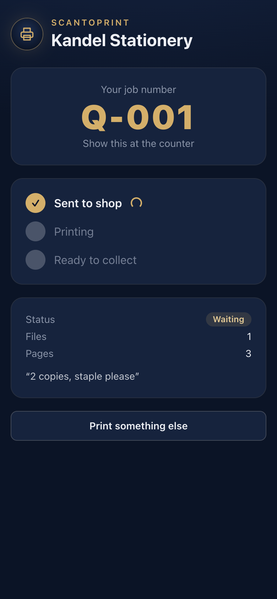
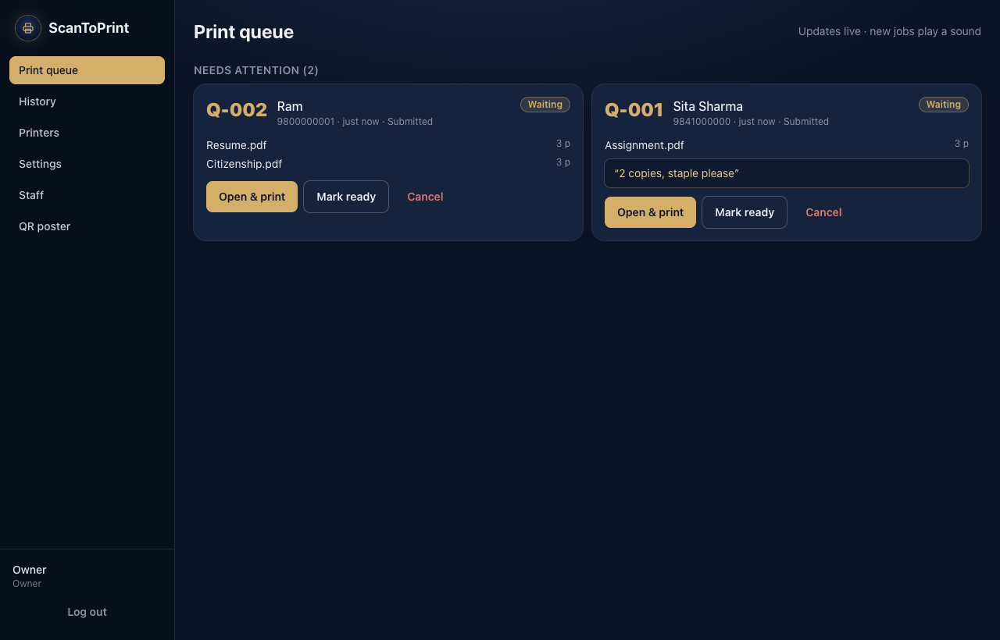
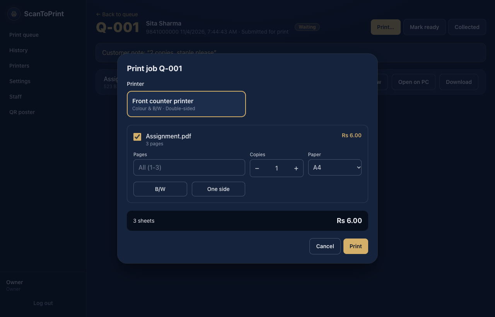

<div align="center">


# ScanToPrint

**QR-code document printing for stationery and print shops.**
Customers scan a QR code, upload their files from their phone, and print, with no email or WhatsApp needed.

[](https://github.com/mk-manishkandel/ScanToPrint/actions/workflows/ci.yml)
[](https://github.com/mk-manishkandel/ScanToPrint/releases/latest)
[](LICENSE)


</div>

---

## Why

Most small print shops still say *"email it to me"* or *"send it on WhatsApp"*. That's slow, it fills the owner's personal inbox with strangers' documents, and every job needs the owner's hands.

ScanToPrint puts a **QR code on the counter** instead. Customers scan it, upload, and either hand the job to staff or print it themselves on the shop's printer.

## Features

**For customers (any phone, no app install)**
- Upload PDFs, photos, Word, Excel, PowerPoint, text files, and more
- **Submit for print:** the job appears instantly on the shop's screen, with your notes
- **Print it yourself:** pick a printer, choose pages, copies, colour or B/W, single or double-sided, and paper size, and see the price before printing
- A job number and live status: *Waiting → Printing → Ready to collect*

**For the shop**
- Live print queue with a sound alert for every new job
- Preview, download or open files on the PC, then print with full options
- Printer setup: choose which Windows printers customers may use, and set their colour, duplex and paper options
- Your own price list, staff accounts (owner / staff roles), and job history with search
- Printable QR poster that detects the PC's network address automatically
- Customer files stay **on the shop PC** and are deleted automatically after N days
- Runs in the system tray, starts with Windows, and **updates itself** with signed updates

**Payment** is a placeholder step for now (always "pay at the counter"). The code is ready for a payment gateway (eSewa, Khalti, FonePay…) to be added.

## Screenshots

| Customer: upload | Customer: choose colour & options | Customer: live status |
|---|---|---|
|  |  |  |

| Staff: live print queue | Staff: print dialog |
|---|---|
|  |  |

## How it works

```
 Customer's phone ──(shop Wi-Fi)──►  Shop Windows PC running ScanToPrint
                                      ├─ Web server (customer page + staff dashboard) :8080
                                      ├─ SQLite database + file storage (C:\ProgramData\ScanToPrint)
                                      ├─ Converts Office files/images → PDF (Microsoft Office or LibreOffice, built-in)
                                      └─ Prints silently to Windows printers (bundled SumatraPDF)
```

Everything runs on the shop's own PC. No cloud account, no subscription, and customer files never leave the shop.

---

## Install (shop owners)

1. Download **`ScanToPrint_x.y.z_x64-setup.exe`** from the [latest release](https://github.com/mk-manishkandel/ScanToPrint/releases/latest).
2. Run it. If Windows shows **"Windows protected your PC"**, click **More info → Run anyway**. The installer isn't code-signed yet; this is expected.
3. Open ScanToPrint and follow the setup: shop name and owner password.
4. Go to **Printers → Scan for printers**, then turn on your printers.
5. For Word/Excel/PowerPoint files the app uses **Microsoft Office** if it's installed on the PC. If not, install the free [LibreOffice](https://www.libreoffice.org/download/). PDFs and photos work without either. Choose which file types customers may send or print themselves in **Settings → File types**.
6. In your Wi-Fi router, **reserve a fixed IP address** for this PC, so the QR code keeps working.
7. In Windows, set the shop Wi-Fi network to **Private**.
8. Open **QR poster**, print it, and put it at the counter.

### Day to day
- ScanToPrint lives in the **system tray** (bottom-right). Closing the window does **not** stop it. Use tray → **Quit** to stop it.
- Staff can open the dashboard from any device on the Wi-Fi: `http://<PC-IP>:8080/admin`.
- **Updates:** when a new version is out, a banner appears in the dashboard. The owner clicks **Install & restart**. Installing waits until nothing is printing.

### Troubleshooting
| Problem | Fix |
|---|---|
| Customers can't open the page | Their phone must be on the shop Wi-Fi. Check the Wi-Fi is set to **Private** in Windows. Make sure the PC's IP matches the QR poster (reserve it on the router). |
| Word/Excel files say "can't convert" | Install Microsoft Office or LibreOffice, then click **Retry convert** on the job. |
| A print failed | Check the printer is on and has paper, then use **Print…** on the job again. |
| Tray tooltip says "NOT RUNNING" | Another program is using port 8080. Close it and restart ScanToPrint. |
| Anything else | Logs are in `C:\ProgramData\ScanToPrint\logs`. [Open an issue](https://github.com/mk-manishkandel/ScanToPrint/issues/new/choose) and attach them. |

---

## Development

| Part | Tech |
|---|---|
| Desktop shell, tray, installer, auto-update | [Tauri 2](https://tauri.app) (`src-tauri/`) |
| Server, API, conversion, printing | Rust: Axum, tokio, SQLite via sqlx (`crates/core/`) |
| Customer page and dashboard | React, Vite, Tailwind CSS (`web/`), embedded into the binary |
| Printing | [SumatraPDF](https://www.sumatrapdfreader.org) (bundled, pinned and checksum-verified) |
| Office → PDF | Microsoft Office via COM when installed, else LibreOffice headless (both installed separately) |

```bash
npm ci
npm run web:build
cargo run -p scantoprint-core --bin dev-server   # http://localhost:8080, data in ./data
npm run web:dev                                  # optional: UI hot reload on :5173
```

Works on macOS, Linux and Windows. Outside Windows, printing goes to a mock printer. See **[CONTRIBUTING.md](CONTRIBUTING.md)** for the project layout, checks and rules.

## Releasing (maintainers)

1. Bump the version in `src-tauri/tauri.conf.json`, `Cargo.toml`, `package.json` and `web/package.json` (CI checks they match). Run `cargo check`, then commit.
2. Create and push a signed tag: `git tag -s v1.2.3 -m "v1.2.3" && git push origin main v1.2.3`
3. GitHub Actions builds the installer, signs the update and **publishes the release**. Installed apps are offered the update within minutes, so only tag a version that's ready to ship.

Release updates are signed with a private key held only by the maintainer. Installed apps reject any update that isn't signed with it. See [SECURITY.md](SECURITY.md).

## Contributing

Issues and pull requests are welcome. Please read [CONTRIBUTING.md](CONTRIBUTING.md) and the [Code of Conduct](CODE_OF_CONDUCT.md). To report a security problem, see [SECURITY.md](SECURITY.md).

## License

[MIT](LICENSE) © mk-manishkandel and contributors.

ScanToPrint bundles **SumatraPDF** (© Krzysztof Kowalczyk et al., GPLv3) unmodified, as a separate program used for printing. See [`src-tauri/binaries/SumatraPDF-LICENSE.txt`](src-tauri/binaries/SumatraPDF-LICENSE.txt). LibreOffice is not bundled.
